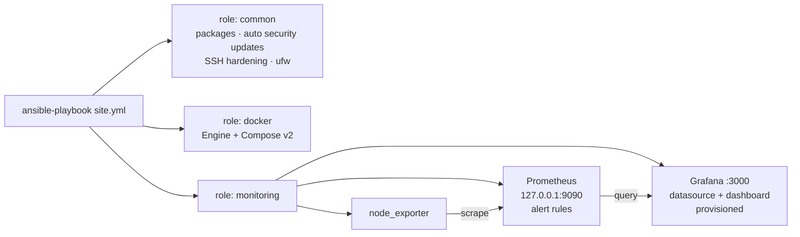

# Ansible: hardened monitoring server (Prometheus + Grafana)

[](https://github.com/iyedboubakri12/ansible-monitoring-stack/actions/workflows/ci.yml)

One command turns a fresh Ubuntu server into a monitored, hardened host: base hardening, Docker, and a **Prometheus + node_exporter + Grafana** stack with a provisioned datasource, **alert rules** and a **dashboard**, all as code.

The CI does not stop at linting: it **runs the playbook against a real Ubuntu 24.04 machine** (the GitHub runner), runs it **a second time to prove idempotence** (`changed=0`), then queries Prometheus and Grafana to check that everything actually works.



## Roles

| Role | What it does | Notable choices |
|---|---|---|
| `common` | base packages, unattended security upgrades, SSH hardening, ufw (deny inbound except SSH and Grafana) | the SSH drop-in is validated with `sshd -t` before it is written, so a typo cannot lock you out |
| `docker` | Docker Engine + Compose v2 from the Ubuntu archive | skipped when Docker is already present |
| `monitoring` | renders the Compose project, Prometheus config, alert rules, Grafana provisioning; starts the stack; waits for health | config is checked with **`promtool`** before start; Prometheus only listens on localhost; containers run read-only with `no-new-privileges`; the Grafana password lives in a `0600` env file and is never logged |

Alert rules: `TargetDown`, `HighCpuUsage` (>85% for 10 min), `LowMemory` (<10% available), `DiskWillFillIn24h` (`predict_linear`).

## CI pipeline

| Job | Checks |
|---|---|
| `lint` | `ansible-lint` with the **production** profile, `--syntax-check` |
| `converge` | playbook run on `ubuntu-24.04` → second run must report `changed=0` → Prometheus `up{job="node"} == 1` and rules loaded → Grafana datasource and dashboard provisioned, anonymous API access refused (401) |

## Use it on your server

```bash
pip install "ansible-core>=2.17"
ansible-galaxy collection install -r requirements.yml -p collections
# edit inventory/hosts.yml with your server
export GRAFANA_ADMIN_PASSWORD='a-long-random-password'
ansible-playbook site.yml
# Grafana: http://<server>:3000  ·  Prometheus (via SSH tunnel): ssh -L 9090:127.0.0.1:9090 <server>
```

For a real environment, keep the password in an `ansible-vault` file instead of the environment.

## Next steps

- Alertmanager with Slack routing (as in my final-year project, where Falco alerts went to Slack).
- TLS in front of Grafana (Caddy or NGINX + Let's Encrypt).
- Molecule scenarios for Debian and Rocky Linux.
